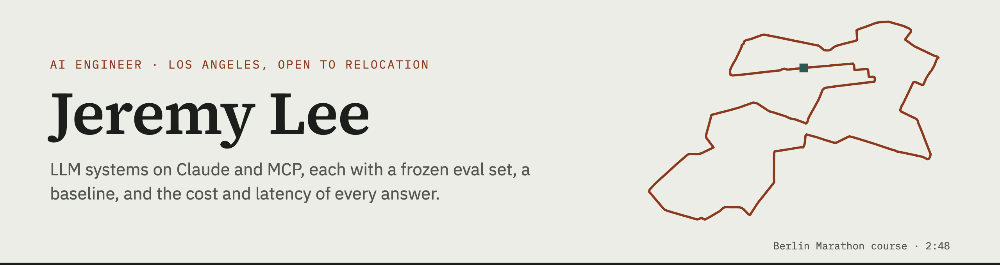

I build LLM systems and the evals that show whether they work. Most recently I led a natural-language analytics platform on Claude and MCP at Kandu (health tech), from proposal to production. Before that I was a data scientist at InstaAgent (Y Combinator), and for nine years co-founder and Chief Strategy Officer of an education company that grew enrollment 5.2 times. MSBA at UCLA Anderson, December 2026 (GPA 3.92).

**Looking for:** AI engineer and applied ML roles. Based in Los Angeles, open to relocation.

**[lyhjeremy.com](https://lyhjeremy.com/)** (all 37 projects) · **[Resume (PDF)](https://lyhjeremy.com/assets/Jeremy-Lee-Resume-AI-Engineer.pdf)** · [LinkedIn](https://www.linkedin.com/in/lyhjeremy/) · [lyhjeremy@gmail.com](mailto:lyhjeremy@gmail.com)

## Start here

- **[Marathon strategy coach](https://github.com/lyhjeremy/marathon-strategy-rag)**: the same Claude model answers three ways: alone, with retrieval, and with my pace and heat models as tools (also served over MCP). On 42 numeric targets frozen before any run: tools 42, retrieval 21, bare model 14. [Write-up with a full tool-call trace](https://lyhjeremy.github.io/marathon-strategy-rag/overview/)
- **[Receipt Auditor](https://github.com/lyhjeremy/receipt-auditor)**: a 1.5B Qwen model fine-tuned on my laptop (LoRA) sorts line items at 90.5% against 80.0% for Claude zero-shot, in 0.19 s per item instead of 3.6 s, at $0 against $3.03 per 1,000. [Write-up](https://lyhjeremy.github.io/receipt-auditor/overview/)
- **[Wine Sommelier RAG](https://github.com/lyhjeremy/wine-sommelier-rag)**: hybrid BM25 and dense retrieval with a cross-encoder reranker over 30,000 reviews; every pick is cited. nDCG@10 0.59 to 0.76 on 30 queries frozen before the run. [Write-up](https://lyhjeremy.github.io/wine-sommelier-rag/overview/)
- **[Podcastify](https://github.com/lyhjeremy/podcastify)**: a whole book becomes a two-host episode where every claim line cites its source sentences and is checked before it is voiced. 7.4 of 12 key points covered against 4.4 for a rule-based script. [Write-up](https://lyhjeremy.github.io/podcastify/)
- **[SkillCompass](https://github.com/lyhjeremy/skill-compass)**: two-minute skill checks in 40+ fields, scored Elo-style, with a FastAPI backend and three LLM features. Runs on $0 a month. [Live](https://lyhjeremy.github.io/skill-compass/)

## How I test AI systems

Every AI project has a test set frozen before the first run, a baseline it has to beat, measured cost and latency, and its main failure written down.

| Project | Result vs baseline | Cost per task | Latency (median) | Main failure |
|---|---|---|---|---|
| [Strategy coach](https://lyhjeremy.github.io/marathon-strategy-rag/overview/) | 42 of 42 vs 21 (RAG), 14 (bare) | $0.017 | 8.4 s (p95 14.6 s, n=11) | Asks for a missing input instead of answering |
| [Wine RAG](https://lyhjeremy.github.io/wine-sommelier-rag/overview/) | nDCG@10 0.76 vs 0.59 dense | $0 retrieval, $0.13 answer | 196 ms retrieval, 8.3 s answer | Ignores a price limit in the sentence |
| [Receipt Auditor](https://lyhjeremy.github.io/receipt-auditor/overview/) | LoRA 90.5% vs Claude 80.0% | $0 vs $0.003 | 0.19 s vs 3.6 s | Labels that split two ways in training |
| [Podcastify](https://lyhjeremy.github.io/podcastify/) | 7.4 vs 4.4 of 12 key points | $0.35 per episode | 3 min 43 s per episode | Repair step left 8 of 165 lines unsupported |

Cost is the API-equivalent price reported by the Claude CLI; local timings on an Apple M4. Each write-up has the eval files and the scripts that produced them.

## Experience

- **Kandu**, Data Engineer, Jul to Sep 2026: led a natural-language analytics platform on Claude and MCP, and the dbt warehouse under it from 13 post-merger systems (HIPAA, GDPR); record linkage from 75.7% to 97.5%.
- **UCLA Anderson**, Data Analyst and graduate student researcher, Jun to Dec 2026: the Office of Inclusive Excellence's first data pipeline; research on LA's deep-tech cluster and on LLM voice agents in debt recovery (36,000 calls).
- **InstaAgent** (Y Combinator), Data Scientist, Jun 2025 to Mar 2026: LLM content generation for nine clients, cutting production cost by more than 80%; engagement models that lifted engagement 25%.
- **Casual Ace Learning Centre**, Co-founder and Chief Strategy Officer, 2016 to 2025: one location to eight, enrollment up 5.2 times and revenue 6.7 times; shipped the learning platform, LLM tutor included.

## The fine-tuning series

Four photo-to-structured-data apps. Each one pairs an LLM pipeline with a small open model fine-tuned on my laptop (LoRA on Qwen2.5) for the same task, then benchmarks base vs. fine-tuned vs. Claude zero-shot on held-out data.

| App | Task for the fine-tuned model | Fine-tuned | Claude zero-shot | |
|---|---|---|---|---|
| [**Receipt Auditor**](https://github.com/lyhjeremy/receipt-auditor) | Spend category for merchants it has never seen | **90.5%** | 80.0%1 | [Live](https://lyhjeremy.github.io/receipt-auditor/) · [Write-up](https://lyhjeremy.github.io/receipt-auditor/overview/) |
| [**Cellar Scanner**](https://github.com/lyhjeremy/cellar-scanner) | Grape variety from a blind tasting note (1.5B model) | **27.7%** top-1 | 23.0%2 | [Live](https://lyhjeremy.github.io/cellar-scanner/) · [Write-up](https://lyhjeremy.github.io/cellar-scanner/overview/) |
| [**Menu Decoder**](https://github.com/lyhjeremy/menu-decoder) | Cuisine and 14-allergen tags from a bare dish name | **99.3%** cuisine with no schema in the prompt; 69.3% allergen recall | 79.2% allergen recall3 | [Live](https://lyhjeremy.github.io/menu-decoder/) · [Write-up](https://lyhjeremy.github.io/menu-decoder/overview/) |
| [**Race Day Copilot**](https://github.com/lyhjeremy/race-day-copilot) | Km-by-km pacing plan from a course map, checked by six deterministic rules (3B model) | 95.7% valid plans; **0.0%** pass all six checks | 90.0% valid; 75.7% pass | [Live](https://lyhjeremy.github.io/race-day-copilot/) · [Write-up](https://lyhjeremy.github.io/race-day-copilot/overview/) |

1. Clean rerun on 2026-10-28: Claude saw only the merchant text and the 12 labels, with tools off. Most of its misses are noisy labels in the test set (hardware and cables marked other). The first run scored 56.0% with a leaked category list. 2. Scored on the same 200 notes, the fine-tuned model is right on 55 and Claude on 46 (sign test p = 0.33), so the gap is within noise. 3. Claude needs the full allergen schema in every prompt to get there; the fine-tuned model gets only the dish name.

## Data stories

Running and wine supply most of the questions: I have run 14 marathons (2:48 in Berlin) and hold WSET Level 3.

- **[Fuel Lockstep](https://lyhjeremy.github.io/fuel-lockstep/)**: Hong Kong's five petrol brands posted the same price on 88% of days from 2020 to 2026, and prices rose 110 times against 33 cuts. Collusion screens against import costs, with Perth and Los Angeles for contrast, plus an [11-page paper](https://lyhjeremy.github.io/fuel-lockstep/paper/fuel-lockstep.pdf).
- **[The Heat Tax](https://lyhjeremy.github.io/marathon-heat-tax/)**: 80 Boston Marathons (1940 to 2019) against ERA5 course weather. Heat costs nothing up to 55°F, then about 0.42% of finish time per °F for the median runner; dew point added nothing. Includes a live race-day forecast, and says plainly that the model did not beat a flat guess on its 2015 to 2019 holdout.
- **[Wine Score Inflation](https://lyhjeremy.github.io/wine-score-inflation/)**: the 100-point scale works like an 8-point one. Nothing in about 120k unique reviews scores below 80, and 85% land between 84 and 92.
- **[Vintage Heat](https://lyhjeremy.github.io/vintage-heat/)**: growing-season weather for 55 wine regions joined to 55,597 unique reviews. A season 1 °C warmer than normal moved scores by 0.24 points in cool regions and 0.08 in warm ones, and the placebo and trend checks weaken even that.
- **[Fame Half-Life](https://lyhjeremy.github.io/fame-half-life/)**: daily Wikipedia views around 1,905 deaths and 178 major awards. Half the extra attention a death brings is gone about two days after the peak, and a year later the page still draws 1.08 times its old traffic. A two-phase decay fits 75% of events best, a share the page tests against simulated curves.
- **[The Negative-Split Myth](https://lyhjeremy.github.io/marathon-negative-split-myth/)**: of 31,912 Boston 2014 finishers, 2.5% ran the faster second half coaches recommend, and the median runner slowed 14%. Across eight Boston years the share runs from 2.4% to 10.8%; 2014 had the hardest fade.
- **[Are Song Lyrics Getting Simpler?](https://lyhjeremy.github.io/lyrics-complexity-over-time/)**: 50 years of Billboard hits doubled in length and got more repetitive, but the vocabulary did not shrink.
- **[Scoring-Table Fairness](https://lyhjeremy.github.io/athletics-scoring-fairness/)**: Kruskal-Wallis tests on 6,400 elite marks. The best performers in some events score 68 points higher than in others.

<strong>More projects</strong>, grouped by theme

#### Generative AI and agents
- [Marathon Strategy RAG](https://github.com/lyhjeremy/marathon-strategy-rag): a tool-calling coach that runs my Boston pace and heat models instead of guessing numbers, with an MCP server for Claude Desktop and Claude Code. On a frozen 43-question gold set it got 42 of 42 numeric values within tolerance (plain RAG 21, bare model 14) and left an unsourced number in 3 of 43 answers (RAG 28, bare 43). [Live](https://lyhjeremy.github.io/marathon-strategy-rag/)
- [Marathon Training Agent](https://github.com/lyhjeremy/marathon-training-agent): a LangGraph agent that drafts a training plan and revises it until it passes explicit safety checks. Streamlit UI. [Live](https://lyhjeremy.github.io/marathon-training-agent/)
- [Wine Pairing Agent](https://github.com/lyhjeremy/wine-pairing-agent): a LangGraph agent that reasons from pairing principles to a style, searches 30,000 indexed reviews as a tool, and critiques its own pick. [Live](https://lyhjeremy.github.io/wine-pairing-agent/)

#### Running and sports analytics
- [Performance Continuum](https://github.com/lyhjeremy/marathon-performance-continuum): distribution fitting and extreme-value theory on 31,842 finishers, and how far the world record sits beyond them. [Live](https://lyhjeremy.github.io/marathon-performance-continuum/)
- [National Strength Profiles](https://github.com/lyhjeremy/national-strength-profiles): k-means and PCA on 43 nations across five disciplines; five archetypes. [Live](https://lyhjeremy.github.io/national-strength-profiles/)
- [Hitting the Wall](https://github.com/lyhjeremy/marathon-pacing-decay): a finish-time and wall-risk predictor trained on 176,059 Boston finishers (2014 to 2023) with conformal intervals, tested on the unseen 2024 race: 7.9 min typical miss at halfway against 18.1 for even pace. Live split card on the write-up. [Live](https://lyhjeremy.github.io/marathon-pacing-decay/)
- [Boston BQ Fairness](https://github.com/lyhjeremy/boston-marathon-qualifying-fairness): are Boston qualifying times equally hard across age and gender groups? [Live](https://lyhjeremy.github.io/boston-marathon-qualifying-fairness/)
- [Marathon Majors Course Difficulty](https://github.com/lyhjeremy/marathon-majors-course-difficulty): three methods for ranking course difficulty across the six Majors, tested on simulated races with planted course penalties; the paired method recovers each within 7.3 s. [Live](https://lyhjeremy.github.io/marathon-majors-course-difficulty/)
- [Marathon Shoe Revolution](https://github.com/lyhjeremy/marathon-shoe-revolution-decomposition): how much of the recent drop in marathon times is the shoes. [Live](https://lyhjeremy.github.io/marathon-shoe-revolution-decomposition/)

#### Language and NLP
- [Mandarin Learning Reader](https://github.com/lyhjeremy/mandarin-learning-reader): a tutor built from any Chinese EPUB, with pinyin over every character, read-aloud and offline pronunciation grading. [Live](https://lyhjeremy.github.io/mandarin-learning-reader/)
- [EPUB Reading-Level Analyzer](https://github.com/lyhjeremy/epub-reading-level-analyzer): grade level, vocabulary richness and word-coverage curve for any EPUB, entirely in the browser. [Live](https://lyhjeremy.github.io/epub-reading-level-analyzer/)
- [Love Island Lexical Analysis](https://github.com/lyhjeremy/love-island-lexical-analysis): 61% of everything said is the top 100 words; about 1,250 words cover 95%. [Live](https://lyhjeremy.github.io/love-island-lexical-analysis/)
- [Podcastify](https://github.com/lyhjeremy/podcastify): turns a whole book or article into a two-host episode through `claude -p`. Every claim line cites its source sentences and is checked before it is voiced. Across four public-domain sources it covered 7.4 of 12 frozen key points against 4.4 for the rule-based mode. [Live](https://lyhjeremy.github.io/podcastify/)
- [EPUB to Audiobook](https://github.com/lyhjeremy/epub-to-audiobook): a desktop app for read-along audiobooks in English, Mandarin and Cantonese. [Live](https://lyhjeremy.github.io/epub-to-audiobook/)

#### Tools and finance
- [When Can I Retire?](https://github.com/lyhjeremy/fire-retirement-simulator): replays a retirement plan through every start year of US market history since 1871 (Shiller data), or a block bootstrap of it, with a stock/bond mix, guardrail spending and a solver for the smallest change that reaches 90%. Checked against the Trinity study and a 1946 to 1993 holdout. [Live](https://lyhjeremy.github.io/fire-retirement-simulator/)
- [Leave Time Optimizer](https://github.com/lyhjeremy/leave-time-optimizer): when to leave to arrive on time, from the Google Maps API. [Live](https://lyhjeremy.github.io/leave-time-optimizer/)
- [Connection Odds](https://github.com/lyhjeremy/connection-odds): how often a US connection fails, built from 21 million flights at the 30 busiest US hubs. A 45-minute layover (45 to 49 minutes) missed 17% of the time; the lookup gives the layover you need for 95%. [Live](https://lyhjeremy.github.io/connection-odds/)
- [downtime-cli](https://github.com/lyhjeremy/downtime-cli): a zero-dependency npm CLI that fills a long build or test run with terminal trivia, then hands you back the untouched output. [Live](https://lyhjeremy.github.io/downtime-cli)

## Toolkit

- **LLM systems:** Claude and MCP, tool use, agents (LangGraph), RAG (BM25, dense, reranking), LoRA fine-tuning, evals with frozen gold sets and LLM judges, grounding checks
- **Engineering:** Python, TypeScript, SQL, FastAPI, React, Git, CI/CD, GCP, Claude Code
- **Modeling:** scikit-learn, PyTorch, XGBoost; survival analysis, causal inference, time series, A/B testing; Gurobi optimization
- **Data:** Snowflake, dbt, Airflow, Spark; apps on Render, Vercel and GitHub Pages

## Education

MSBA, UCLA Anderson School of Management (Dec 2026, GPA 3.92) · graduate analytics coursework, Georgia Tech · BBA in Accounting and Finance, University of Hong Kong

Design and copy across these repos follow [these standards](DESIGN_STANDARDS.md).
